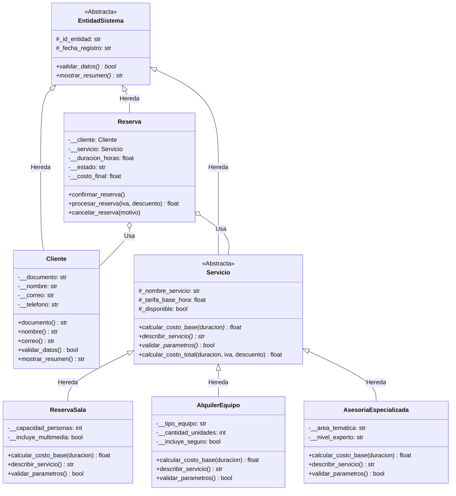

# Sistema de Gestión: Software FJ (Fase 4 - UNAD)

**Curso:** Programación (213023)  
**Actividad:** Fase 4 – Ejercicio 1 (Gestión de Clientes, Servicios y Reservas)

---

## 1. Descripción del Proyecto
Aplicación en **Python** orientada a objetos para gestionar **Clientes**, **Servicios** (*Reserva de Salas, Alquiler de Equipos y Asesorías Especializadas*) y **Reservas** de la empresa *Software FJ*.  
Toda la información se maneja en memoria mediante listas y objetos, aplicando clases abstractas, herencia, polimorfismo, encapsulación y manejo de excepciones con registro en el archivo `software_fj_eventos.log`.

---

## 2. Diagrama de Clases del Sistema



---

## 3. Distribución de Módulos (5 Integrantes)

El archivo `sistema_software_fj.py` está dividido en **5 módulos** (uno para cada integrante). Para que las 5 partes funcionen juntas al ejecutar el archivo completo, mantenemos los nombres de clases y métodos acordados en cada módulo:

### Módulo 1 – Estudiante 1: Excepciones, Logs y Clase Abstracta Base
* **Contenido:**
  1. Excepciones personalizadas que heredan de `Exception`:
     - `SoftwareFJError` (base), `DatosInvalidosError`, `ParametroFaltanteError`, `ServicioNoDisponibleError`, `OperacionNoPermitidaError`, `CalculoInconsistenteError`.
  2. Clase `GestorLogs` con el método `registrar(nivel, mensaje)` que guarda los eventos y errores en `software_fj_eventos.log`.
  3. Clase abstracta `EntidadSistema(ABC)` con atributos `_id_entidad`, `_fecha_registro` y los métodos abstractos `validar_datos()` y `mostrar_resumen()`.

---

### Módulo 2 – Estudiante 2: Clase `Cliente` (Encapsulación y Validaciones)
* **Contenido:**
  1. Clase `Cliente(EntidadSistema)` que hereda de la clase base.
  2. Constructor: `def __init__(self, id_cliente, documento, nombre, correo, telefono):`
  3. Atributos privados (`__`): `__documento`, `__nombre`, `__correo`, `__telefono`.
  4. Propiedades (`@property` y `@setter`) con validaciones:
     - Si el nombre, documento, correo o teléfono están vacíos -> lanzar `ParametroFaltanteError`.
     - Si el correo no incluye `"@"` o el documento/teléfono no son numéricos -> lanzar `DatosInvalidosError`.
  5. Implementar `validar_datos()` y `mostrar_resumen()`.
* **Cómo probar este módulo:**
  ```python
  # Prueba con datos válidos:
  c1 = Cliente("CLI-001", "1020304050", "Ana Maria Gomez", "ana.gomez@empresa.co", "3001234567")
  print(c1.mostrar_resumen())

  # Prueba con correo inválido (debe lanzar DatosInvalidosError):
  c2 = Cliente("CLI-002", "1020304050", "Pedro", "correo_sin_arroba.com", "3001234567")
  ```

---

### Módulo 3 – Estudiante 3: Clase Abstracta `Servicio` y 3 Clases Hijas
* **Contenido:**
  1. Clase abstracta `Servicio(EntidadSistema, ABC)` con atributos `_nombre_servicio`, `_tarifa_base_hora`, `_disponible = True`.
  2. Métodos abstractos: `calcular_costo_base(duracion_horas)`, `describir_servicio()`, `validar_parametros()`.
  3. Método sobrecargado `calcular_costo_total(duracion_horas, impuesto_iva=0.0, descuento_pct=0.0)` con parámetros opcionales y encadenamiento (`raise CalculoInconsistenteError(...) from error_origen`).
  4. Tres clases hijas:
     - `ReservaSala(Servicio)` (`capacidad_personas`, `incluye_multimedia=False`).
     - `AlquilerEquipo(Servicio)` (`tipo_equipo`, `cantidad_unidades`, `incluye_seguro=True`).
     - `AsesoriaEspecializada(Servicio)` (`area_tematica`, `nivel_experto="JUNIOR"`).

---

### Módulo 4 – Estudiante 4: Clase `Reserva` y Gestor del Sistema
* **Contenido:**
  1. Clase `Reserva(EntidadSistema)` que integra `cliente`, `servicio` y `duracion_horas`.
  2. Métodos con manejo de excepciones:
     - `confirmar_reserva()`: Usa `try / except / else` para validar disponibilidad y pasar el estado a `"CONFIRMADA"`.
     - `procesar_reserva(impuesto_iva=0.0, descuento_pct=0.0)`: Usa `try / except / finally` para calcular el cobro y pasar a `"PROCESADA"`.
     - `cancelar_reserva(motivo)`: Cambia el estado a `"CANCELADA"` y libera el servicio (`disponible = True`).
  3. Clase `SistemaSoftwareFJ` con las listas en memoria (`self.clientes`, `self.servicios`, `self.reservas`).

---

### Módulo 5 – Estudiante 5: Simulación de las 10 Operaciones de Prueba
* **Contenido:**
  1. Función `ejecutar_simulacion()` que crea el sistema y corre las operaciones de prueba en secuencia (registros válidos e inválidos de clientes, creación de servicios, reservas exitosas con sobrecarga de costos y reservas fallidas).
  2. Resumen final en consola mostrando los registros creados y el archivo `software_fj_eventos.log`.

---

## 4. Cómo ejecutar el programa

Abrir la terminal en la carpeta del proyecto y ejecutar:
```bash
python sistema_software_fj.py
```
